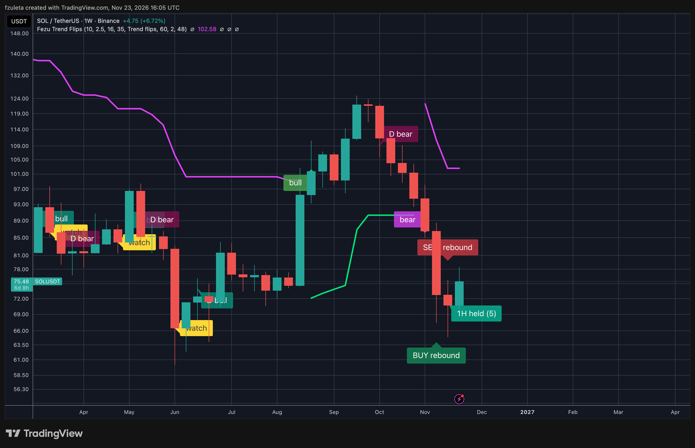
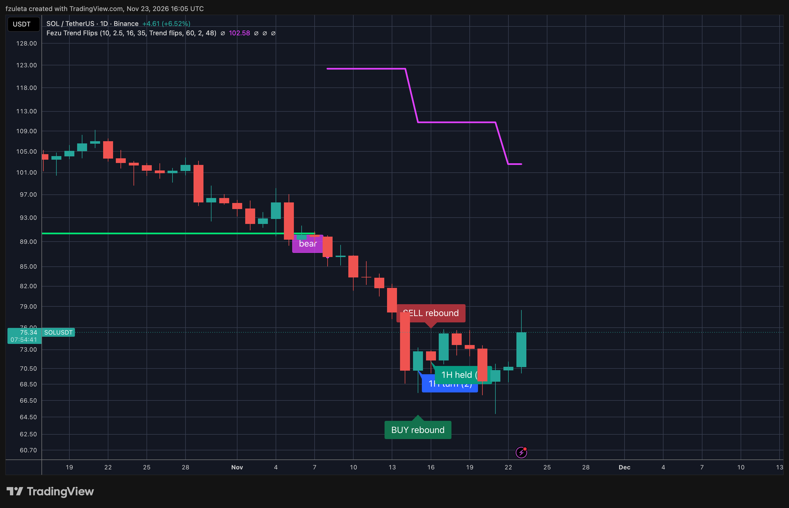

# Fezu Trend Flips

A Pine Script v6 overlay for TradingView. It plots a confirmed weekly Supertrend and marks daily trend changes. A separate hourly model tracks rebounds after deep selloffs, so a BUY rebound can appear while the weekly trend is still bearish.

## Use on a chart

1. Open [Fezu-Trend-Flips.pine](Fezu-Trend-Flips.pine) and copy the entire file.
2. In TradingView's Pine Editor, create a new indicator, replace its contents, save it, and select **Add to chart**.
3. Choose standard time-based candles on an intraday, 1D, or 1W chart. The weekly model defaults to ATR length 10 and factor 2.5. Enable **Require 2 consecutive confirmed bars** if you want a second weekly close to confirm a change.

## Chart examples

### Weekly trend and daily flips

On this SOL/USDT weekly chart, the green **bull** label in August marks a confirmed weekly reversal. In October, **D bear** appears while the weekly line is still green. The magenta **bear** label and line follow when the weekly trend also turns bearish.

### Hourly rebound on daily candles

The daily chart zooms in on the November selloff. **BUY rebound** marks the day an hourly entry triggered, and **SELL rebound** marks the following exit. The weekly line stays magenta above price through both events. Hover over a rebound label in TradingView to see the hourly close price and time.

## Reading the signals

| Chart marking | What it means |
| --- | --- |
| Green or magenta weekly line | The last accepted weekly trend is bullish or bearish, respectively. With two-bar confirmation enabled, orange marks a pending change. |
| Green or magenta shading | Fills the area between each chart candle’s close and the confirmed weekly line. **Trend fill opacity (%)** defaults to 20. Set it to 0 to hide the fill. Pending weekly changes leave a gap. |
| D Bull / D Bear | The daily trend flipped at a confirmed daily close. |
| Developing weekly flip | A preview based on the open week. It can disappear before the weekly close. |
| Selloff and recovery markers | A 15-minute or hourly momentum watch after a deep drawdown. The default interval is one hour. |
| BUY rebound / SELL rebound | A confirmed hourly rebound entry or trailing exit. When several events fall on one chart bar, the label shows the latest side and the tooltip lists the events in order. |

The comparison snippet in `tests/compare-entries.pine.inc` is optional. Append it to a temporary copy to compare historical entry rules in Pine Logs.

## Disclaimers

This project is for education and research. Its labels and alerts describe conditions in the code. They do not constitute financial, investment, or trading advice, a recommendation, or an offer to buy or sell any asset. You are responsible for your own decisions and can lose the capital you trade.

Historical signals and hypothetical comparisons do not guarantee future results. A marker records a calculated price and time. An actual order may fill later, at another price, or never fill. Fees, spread, slippage, market data, session settings, and available intraday history can affect comparisons. In particular, an hourly event shown on a weekly candle only became observable when the relevant hour closed.

The software is provided as is, without warranty of accuracy, availability, fitness for a particular purpose, or profitability. To the extent permitted by applicable law, the authors disclaim liability for losses arising from its use.

Fezu Trend Flips is independently developed and has no third-party sponsorship or endorsement.
